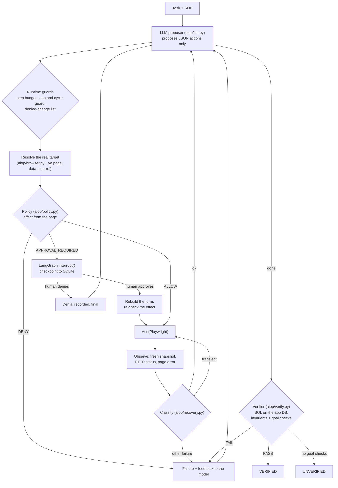

# Architecture

## The loop

Everything left of the model's arrow is deterministic. The model never sees a permission, never writes an approval,
and its "done" is only the start of verification. Each box writes to the evidence folder `runs/<run_id>/`.

## Where things live

| Concern | File | Notes |
|---|---|---|
| The run, budgets, guards, dispatch, approvals, recovery | `aiop/runtime.py` | runs without LangGraph too (`run_until_blocked`) |
| Checkpoints and the approval door | `aiop/graph.py` | thin: nodes call runtime methods |
| What the model may say | `aiop/models.py` | pydantic, extra keys forbidden |
| Talking to the model | `aiop/llm.py` | any OpenAI-compatible endpoint; one repair attempt; truncation detected |
| The browser | `aiop/browser.py` | goto, click, fill, select, read; origin allow-list; no JS tool |
| Policy | `aiop/policy.py` + `companies/<id>/policies.yaml` | effect → ALLOW / APPROVAL_REQUIRED / DENY; strictest wins |
| Verification | `aiop/verify.py` + `companies/<id>/checks.yaml` | read-only SQL; invariants for any task, goals per task |
| Slot assignment | `aiop/assign.py` | matroid greedy with a matching check |
| Company knowledge | `companies/<id>/` | SOP, policies, checks, seed; `aiop/` has no business words |

## How an effect is decided

1. `data-aiop-effect` on the clicked control, and on the selected options of the form it submits.
2. Otherwise, fallback rules in `policies.yaml`: method, form action path and field values.
3. Otherwise, the conservative default from `policies.yaml` (APPROVAL_REQUIRED in both companies).

If several effects apply, the strictest decision wins. The model's own description of the action is never read.

## State and evidence

The LangGraph checkpoint holds a small `RunState`: ids, counters, the plan, notes, the pending approval and summaries.
Full snapshots, screenshots, LLM usage, database dumps and the report go to `runs/<run_id>/`. A run waiting for a human
survives a restart of the process.

---

## Security and threat model

The operator acts inside real business systems on someone's behalf, so the model has to be treated as an untrusted
component that is usually right.

| Risk | What could happen | Mitigation here |
|---|---|---|
| Prompt injection from page content | a resume or a loan remark tells the AI to skip the SOP or approve something | the policy decides by the real effect of a control, not by the model's words; consequential effects need a human; the `INJECTION` switch exercises this |
| Misleading UI | a page shows success but nothing was saved | the verifier checks the database, not the page (`SILENT_FAIL` switch) |
| Model claims success | the model says "done" on unfinished work | "done" triggers verification; a run that stops early is verified anyway |
| Irreversible actions | rejecting a candidate, paying out money | APPROVAL_REQUIRED via interrupt; DENY for payouts with unverified documents or beyond the day's funds |
| Repeating a denied action | the model keeps asking for the same change | denials are remembered and the identical change is refused |
| Leaving the company's systems | following a link to another site | navigation is limited to the origins in `company.yaml` |
| Excessive capability | arbitrary JavaScript, downloads, file access | none of these tools exist; downloads are disabled in the browser context |
| Runaway loops and cost | retrying forever | per-step retry cap, step budget, loop and cycle guards, re-plan budget |
| Machine endpoints | the model resets the app or calls an admin route | `deny_paths` in `policies.yaml` |
| Auditability | nobody can tell what happened | every proposal, decision, approval, failure and verification is in the timeline |

**Not claimed:** production credential isolation, complete resistance to prompt injection, identity and access
management, data-exfiltration prevention, a hardened browser sandbox, secrets management, or verification adapters for
real company APIs (here the verifier reads the mock apps' SQLite). The mock apps run locally and every record in them is
fictional.
